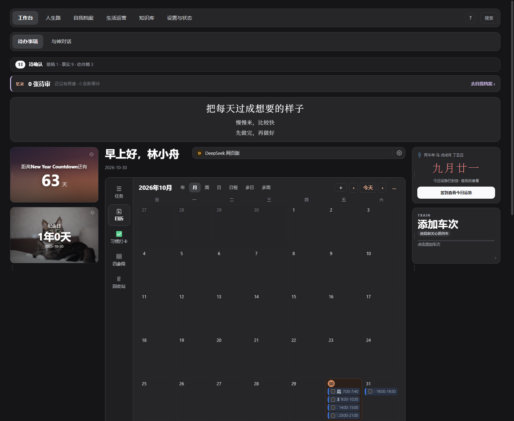
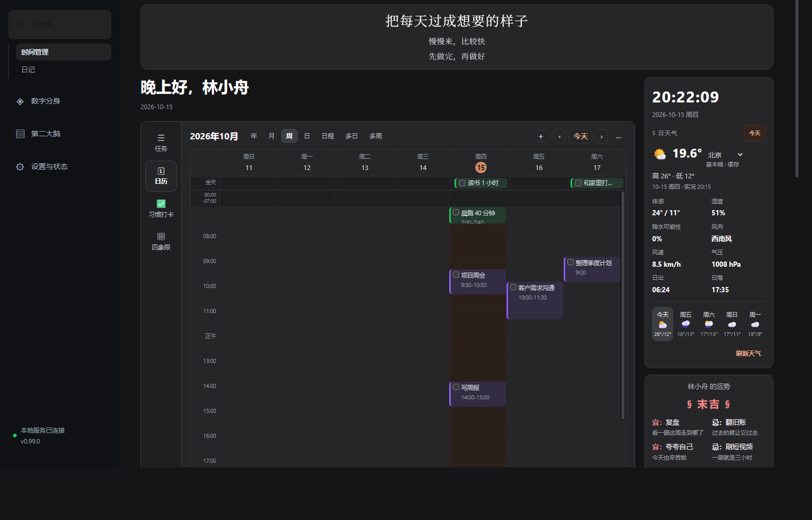
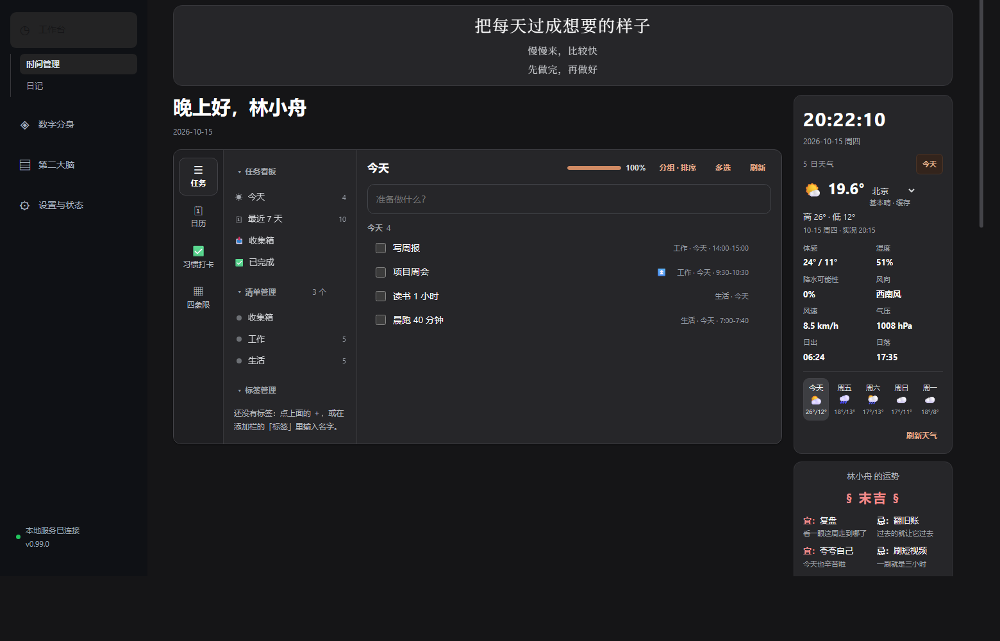

# 薪火OS（Torch OS）· 0.99

> 一个**本地优先**的个人 AI 工作台：记录、记忆、目标与时间管理都住在你自己的电脑上。
> 数据是本体，DeepSeek Harness 是唯一的 AI 入口——它直接读写当前库，重要改动请自行备份。
>
> *A local-first personal AI workbench. Your data stays on your machine, in plain Markdown.*

本地服务跑在 `127.0.0.1`，用 Obsidian（或任意浏览器）当界面；人生路、自我档案、生活运营、
知识库与任务都以 **Markdown 文件**为数据本体，SQLite 只做索引、投影与审核状态。
torch 自身不联网、不保存模型密钥；AI 由本地 DeepSeek Harness（dsh）提供。

## 能干什么

- **工作台**（保持不变）：问候语 + 横幅（座右铭/统计）+ 时钟、5 日天气、黄历；
  以及一整块**时间管理模块**——
  - **任务（2026-10-17 起，新任务一任务一笔记）**：在 Obsidian 库里新建一篇 Markdown；
    任务标题就是文件名，清单就是子文件夹（收集箱任务在 `00_人生路/08_任务与待办/任务/` 根目录），
    改名/换清单会同步改名/移动文件，重名自动编号。任务板从这些笔记聚合，旧式的
    `任务（tasks）.md` 复选框任务原地保留、应用内只读（仍可在 Obsidian 里改）。
    二级侧边栏（看板 / 清单 / 标签）、日期·时间·优先级·标签·清单、单击选中与多选批量、
    右键菜单、分组排序，以及行内/右键的**打开文档**入口；任务行可直接拖到侧栏清单或
    收集箱（从清单拖出），在同一分组内上下拖动可**手动排序**（顺序写进笔记 frontmatter
    的 `排序` 字段，首次拖动会自动切到「手动」排序；滴答侧暂不回写顺序），
    四象限里拖动任务可换到另一格改变优先级；
  - **日历**：七种视图一站齐——**年 / 月 / 周 / 日 / 日程 / 多日（2·3·5·7 天）/ 多周（2·3·4 周）**，
    一排按钮直接切；任务按清单颜色着色；有时间的任务在时刻轴上按时长摆放（重叠自动并排），
    没时间的进「全天」区；凌晨空白时段折成一行；点某处空白就能在那一刻加任务；
  - **习惯打卡**与**四象限**（艾森豪威尔四格 ↔ 高/中/低/无优先级）。
- **与神对话**：工作台内嵌完整的 DeepSeek Harness（dsh）Web UI。torch 自动检测
  `dsh`，缺失时用 `npx` 启动；界面通过同源 `/harness/` 代理加载，浏览器和 Obsidian
  内嵌都可用。模型、密钥与权限都在 dsh 内配置；torch 不再有自己的聊天页或本地回答。
  dsh 的长期工作流规则内置在仓库 `dsh/AGENTS.md`（开场读四库、确认后自动分类归档、
  边界约束），torch 启动时注入 `DSH_AGENTS_HOME`，换库也生效；见 `docs/DSH_WORKFLOW.md`。
- **人生路**：日记、任务与待办、反思复盘、心得体会、目标、项目、习惯追踪、工作复盘。
  2026-10-26 布局 v2 把章节目录收进分组：反思/周复盘/月复盘在 `00_人生路/02_反思复盘/`，
  年度/季度/月度目标在 `00_人生路/04_目标/`，项目计划与项目复盘在 `00_人生路/05_项目/`；
  日记、任务与待办、习惯追踪、会议收获、踩坑记录路径不变，旧库用设置 →「库结构与迁移」的
  逐文件预览搬到 v2（新库直接按 v2 创建）。侧边栏把人生路章节折成四个一级分组（心得体会 /
  反思复盘 / 目标 / 项目）：点分组标题展开或收起，当前章节所在分组会自动展开，方向键只经过
  可见章节。日记与工作台共用同一份 `00_人生路/01_日记/YYYY-MM-DD.md`；「写今日日记」
  「打开本周复盘 / 打开本月复盘」只在 Obsidian 里打开对应笔记（没有就由 Obsidian 新建），
  插件不生成内容、不调用模型。
- **自我档案**：内核与三观、记忆与自传、想法与灵感、情感与关系、意义与目标、沉淀与创作。
- **生活运营**：健康与体重、财富与记账、体检与医疗、证件与事务。体重/账目按「月度 Markdown
  表」保存，每行有稳定 `row_id`；页面只读展示，点「在 Obsidian 打开月度表」到 Obsidian 里
  新增、修改或删除行。
- **知识库**：收件箱、主题笔记、读书笔记、课程笔记、概念卡片、方法库、输出与作品。
  「＋ 在 Obsidian 新建」默认落在收件箱；整理建议按目标章节分组、标注置信度，
  只读展示，移动/改名请到 Obsidian 里做。
- **四库工作台（只读）**：顶部导航一键切换；每库有章节轨、最近记录、搜索与详情阅读，
  插件自己不写 Markdown——标题、正文、标签、章节都在 Obsidian 原生编辑器里改。
  每库右上角「＋ 在 Obsidian 新建」直接由 Obsidian 建文件并打开（浏览器模式走 `obsidian://new`），
  空状态、快捷卡和「写今日日记」同样只负责跳转。人生路右侧有「最近 7 天」日记圆点，
  点一天就能打开当天记录。笔记详情可复制 Obsidian 双链/路径、查看反向链接，标签与章节
  请点「在 Obsidian 打开并编辑」回去改；全局搜索支持 `Ctrl/⌘ K` 和 ↑↓ 选择。
- **体验细节**：顶部 `?` 可直接打开帮助；按 `?` 打开快捷键总览，`g` 后按
  `w/l/s/o/k/,` 跳到工作台/人生路/自我档案/生活运营/知识库/设置，`n` 在四库打开
  「在 Obsidian 新建」、在工作台聚焦任务输入；方向键可在顶部标签、设置侧栏、四库章节轨与任务页
  标签间移动（Home/End 到两端）。首次使用会显示可关闭的「先做一件小事」引导；
  列表与搜索使用「今天 / 昨天 / 10月22日」友好日期；真正不可逆的操作（彻底删除/清空回收站、
  回滚迁移、清除滴答凭据）使用危险色确认；小屏标签栏单行横向滚动、
  任务主区优先展示，四库右栏信息下移保留。
- **薪火管家**：每库右上角「管家」提供确定性的收件箱分流与原则提炼提案、四库结构健康检查。
  提案与体检都只读，卡片上的「在 Obsidian 打开原文」只负责跳转；自由问答统一在「与神对话」的 dsh 里。
- **库结构与迁移**：设置页可生成旧目录/人生路 v1 章节目录 → 四库 v2 的逐文件预览；确认后
  自动备份、移动、改写内部链接并重建索引，支持按 run 回滚。
- **个人数据库（2026-10-26）**：设置 →「Obsidian 库连接」→「个人数据库」显示当前库路径与
  模板只读预览（四库章节只有一份来源：后端 `backend/app/vault_layout.py`，设置页只展示、
  不能在界面里改）；填父文件夹 + 名字点「创建新的个人数据库」，只新建一个文件夹：四库章节、
  `_系统`/`任务`、`.torch-os/vault-layout.json`、`.obsidian` 预设与 torch 插件、种子身份笔记
  一次成型，不碰当前库、不覆盖非空文件夹。切库在 Obsidian 里打开另一个库即可（每个库自己的
  后端从 9168 起挑端口）；浏览器模式仍用「切换到此工作区」写 `.env`、重启服务后生效。
- **DeepSeek Harness**：唯一的 AI 入口。torch 提供 12 个只读 MCP 工具供 dsh 读取四库；
  模型与凭据由 dsh 自己管理，torch 不保存、不回显、不导出。

## 截图

（虚构示例数据，QA 隔离工作台实拍）

| 工作台 | 日历 · 月视图 |
|---|---|
|  |  |

| 日历 · 周视图 | 时间管理 · 任务页 |
|---|---|
|  |  |

## 快速开始（Windows / Python 3.12）

首次安装**四步**，全在本机完成：不需要管理员权限、torch 默认不联网。AI 由 DeepSeek Harness 提供，需要 Node.js >=24.9；未安装全局 dsh 时首次启动会用 npx 自动下载。

> 换电脑/交接：见 `docs/换机交接与后续开发规划-2026-10-22.md`。配置好路径后先跑
> `.\.venv\Scripts\python.exe scripts\check_handoff.py` 做只读自检。

| # | 做什么 | 靠什么 |
|---|---|---|
| 0 | 确认机器上有 Python 3.12 | `python --version`（没有就装，见下） |
| 1 | 初始化环境：venv + 依赖 + `.env` + 示例数据 | 双击 `安装.cmd`（唯一的安装入口） |
| 2 | 起本地服务 | `scripts\start.ps1` |
| 3 | 把工作台装进 Obsidian（推荐） | `scripts\install-obsidian-plugin.ps1` |

首次点击「与神对话」时，torch 会启动本地 dsh：优先使用已安装的 `dsh`，否则使用
`npx -y @deepseek-ai/dsh web`。也可提前安装：

```powershell
npm install -g @deepseek-ai/dsh
```

### 0. 前置：Python 3.12

**仓库里不含 Python**，第一件事是确认它真的在：

```powershell
python --version    # 期望看到 Python 3.12.x
```

没装的话，症状是命令弹出微软商店、或报 “Python was not found”——那是 Windows 自带的空壳别名，等于没装。装一个（按用户安装，不要管理员权限）：

```powershell
winget install --id Python.Python.3.12 --source winget --scope user
```

装完**新开一个终端**再验一次（PATH 要新会话才刷新）。已有别的 Python 也行，把后面命令里的 `python`
换成 `py -3.12` 或解释器全路径即可。图形安装器也依赖它——没装时双击 `安装.cmd` 会给出安装命令并打开下载页。

### 1. 初始化环境

先把仓库拿到本地：`git clone <本仓库地址>`，或下载 ZIP 解压。然后在资源管理器里打开仓库文件夹，
**双击根目录的 `安装.cmd`**——这是唯一的安装入口，会打开图形安装器：

- 建 `.venv`，按 `requirements.lock.txt` 装依赖：先体检本机，版本已经对上就跳过，不重复安装、不重复走网络；
- 缺依赖时逐条安装，日志就在窗口里；官方源失败可自动换清华镜像重试一次；
- 顺手生成 `.env`；示例数据可选（已有库不会被删东西，只有同名文件会被覆盖）；
- 可选：直接选一个 Obsidian 库，把插件装进去；
- 装完点「启动工作台」，浏览器直接打开 `http://127.0.0.1:8765`。

安装器只做安装，不碰你的笔记；不想选的步骤留空即可。**重复打开是安全的**：已完成的步骤会自动跳过，
以后要补依赖、补示例数据、或者再装一个 Obsidian 库，重新双击 `安装.cmd`、只勾需要的项就行。
安装器本体在 `scripts\install_gui.py`（只用标准库，依赖装好之前就能跑）。

想单独确认依赖装没装齐（只读、不联网，不装任何东西）：
`.\.venv\Scripts\python.exe scripts\check_deps.py`。

### 2. 起服务

用图形安装器装完的，直接点安装器里的「启动工作台」即可；手动启动用：

```powershell
powershell -NoProfile -ExecutionPolicy Bypass -File scripts\start.ps1
```

打开 <http://127.0.0.1:8765>。默认只监听本机回环地址，不对外开放。

### 3. 装进 Obsidian（推荐）

安装器里勾选「把工作台装进 Obsidian」，选择**库根目录**——有 `.obsidian` 文件夹的那一层。
安装器只写两处：`.obsidian\plugins\torch\`（插件本体，外加预填了本机仓库路径的 `data.json`）
和 `community-plugins.json`（预启用），不碰库里任何笔记。

想再装进另一个库：重新打开 `安装.cmd`，只勾这一项、选那个库即可（其它步骤会自动跳过）。

装完在 Obsidian 里：

1. **完全重启 Obsidian**——`.obsidian\plugins` 的改动不会热加载；
2. 首次会弹「信任仓库作者并启用插件」，点确认；
3. 左侧 ribbon 出现**薪火OS**图标，或 `Ctrl+P` 搜「打开工作台」。

**在哪个库打开插件，哪个库就是工作区（0.99 起）：** 插件会按当前 Obsidian 库自动选择一个后端实例
（`PORT` 从 9168 起挑空闲端口，`VAULT_DIR` = 当前库，数据放在当前库的 `.torch-os/`），
所以在库 A 看到的是 A 的任务/日记/记忆，在库 B 就是 B 的一套；不同库不会混。
8765 留给浏览器/手动模式，两边可以同时运行。
启动后端用的是「仓库路径/.venv/Scripts/python.exe」，所以**第 1 步必须先做完**。
插件设置页可改仓库路径、Python 路径、是否自动拉起与候选服务地址；端口和启动日志在
`当前库/.torch-os/`。浏览器直开 `http://127.0.0.1:8765` 时仍按 `.env` 的工作区运行，两者互不影响。

> 注意：**不同库的数据不自动拷贝**。原来的 `data/vault`（或另一个工作区）里的任务、日记、记忆
> 只属于那个工作区；想在新 Obsidian 库里看到，需要手动复制对应的 Markdown/`.torch-os`，或在浏览器模式里继续用原工作区。

### 卡住了看这里

| 现象 | 原因与处理 |
|---|---|
| `python` 弹出微软商店 / “Python was not found” | 只有商店别名，真身没装 → 回第 0 步；装完要新开终端 |
| 双击 `安装.cmd` 提示找不到 Python | 图形安装器也需要 Python 3.12 → 按窗口里的 `winget` 命令装好，重新双击 |
| 图形安装器里依赖装到一半失败（`ReadTimeoutError` 等） | 确认「自动换清华镜像重试」是勾着的，再点「开始安装」；仍失败就看窗口日志里的 pip 原始报错 |
| 想确认依赖装没装齐 | `.\.venv\Scripts\python.exe scripts\check_deps.py` —— 不联网，逐条比对 `requirements.lock.txt` 并点名缺哪条 |
| `No module named venv` | 用的是嵌入式/精简版 Python → 换 python.org 或 winget 的完整版 |
| Obsidian 左侧没有图标 | 没完全重启；或选库时选错了一层（要选有 `.obsidian` 的根目录）；或处于限制模式 |
| 打开视图提示连不上服务 | 第 1 步没做完（缺 `.venv`）；或查看 `当前库/.torch-os/logs/torch-backend-*.log` 里的启动报错；端口由插件自动挑，不再固定 8765 |

- 浏览器模式的数据落在 `.env` 的工作区（默认 `data\`，整个目录都被 Git 忽略）；
  在 Obsidian 插件里，每个库的数据落在该库自己的 `.torch-os\`，见下方「工作区」。
- 前端是原生 ES 模块 + 一个 CSS 文件，**不需要 Node 构建**；Node 用于离线前端测试，也是 DeepSeek Harness 的运行前提。

## 设计原则

1. **四库是唯一结构**：`00_人生路`（过程）、`01_自我档案`（我是谁）、`02_生活运营`（数据）、
   `03_知识库`（可复用知识）。工作台任务与待办在 `00_人生路/08_任务与待办`：
   任务笔记在 `任务/`，配置与迁移记录在 `_系统/`；不再使用 `00-System`。
2. **能用 Markdown 就用 Markdown**：日记、四库笔记、任务、体重/账目月度表都是 vault 里的
   普通 `.md`；SQLite 只做索引、投影和审核状态。工作台写入只做「外科手术式写回」——按行/按文件
   定位、原子替换、冲突就报错让页面刷新；四库的 Markdown 由 Obsidian 直接编辑。新任务是一任务一笔记
   （`00_人生路/08_任务与待办/任务/清单/标题.md`，正文随便写）；产品托管的固定文件用「中文（english）.md」
   命名（`任务（tasks）.md`、`身份（identity）.md`），旧名字仍然照常读写。
3. **一个数据只有一个权威源**：日记、习惯、体重、账目都以 Markdown 为准；SQLite 投影随时
   可以删除重建。工作台写入路径保持不变，但底层数据跟随四库。
4. **记忆永不自动确认**：任何自动流程只能写「候选」，确认/拒绝只能由人在界面里点。
   记忆候选只从自我档案和显式 `memory: true` 的笔记里提取。
5. **数据边界**：torch 自身只访问固定天气白名单；所有 AI 请求由 dsh 按它自己的配置发起。
6. **只留一个 AI 入口**：界面负责手动操作，DeepSeek Harness 负责自然语言，两边读写同一份数据。
7. **手动写入只在 Obsidian**：插件里的四库只读——只浏览、搜索、看反向链接，**不写 Markdown**；
   新建、改标题/正文/标签、移章节、记体重账目都跳回 Obsidian 原生编辑器完成
   （插件内走 `torch:new-note` 宿主桥，浏览器模式退回 `obsidian://new`）。工作台的任务、日历、
   习惯打卡、四象限、滴答同步、备份与迁移不受影响，仍在插件内编辑。
8. **先提议、后执行**：迁移仍先生成预览，用户确认后才由后端执行，移动前强制备份、操作可回滚；
   管家与归档建议只做只读提示（2026-10-26 起不提供执行入口），动手仍在 Obsidian。

## 目录结构

```
backend/app/       FastAPI 本地服务（工作台、四库、日记、迁移、习惯、天气、备份…）
frontend/          原生 ES 模块前端（四库页面在 pillars.js / pillar-*.js；任务日历在 tasks-calendar*.js）
obsidian-plugin/   把工作台内嵌进 Obsidian 的薄插件（免构建）
scripts/           启动、图形安装器、依赖体检、自检、发布自检、浏览器探针、校验
tests/             Python 行为测试（后端）
frontend/tests/    前端模块与交互测试（Node 内置 test runner）
examples/          全虚构的示例资料（QA 隔离工作台用它起步）
安装.cmd           双击打开图形安装器（唯一的安装入口）
```

## 开发与测试

```powershell
# 全量校验：Python 测试 + 文本/结构守卫 + 模块面 + 前端语法与测试 + 编译 + 依赖一致性
powershell -NoProfile -ExecutionPolicy Bypass -File scripts\check_all.ps1

# 只跑后端
.\.venv\Scripts\python.exe -m pytest -q

# 只跑前端
node --experimental-vm-modules --test frontend/tests/*.test.mjs
```

当前状态、最近验证结果与下一步见 [`docs/STATUS.md`](docs/STATUS.md)；
已移除接口、deprecated 表与兼容说明见 [`docs/DEPRECATIONS.md`](docs/DEPRECATIONS.md)。

想要一个**隔离验收环境**（独立库、全虚构数据，随便折腾）：

```powershell
.\scripts\start-qa.ps1          # http://127.0.0.1:8766
```

## 工作区（用户文件夹）

**换用户就是换文件夹**。一个工作区 = 一个人的 Obsidian 库根目录；应用自己的 SQLite 索引、
记忆、审计、备份、恢复副本与导入都放在这个文件夹下的 `.torch-os\`（隐藏目录，Obsidian 不显示，
扫描也按点目录跳过）。拷贝整个文件夹 = 拷贝这个人的全部数据。

- **Obsidian 插件模式（0.99 起）**：在哪个库打开，哪个库就是工作区。插件按库自动启动/复用一个
  独立后端实例（端口、`VAULT_DIR`、`.torch-os` 都是该库的），设置页里的工作区切换在插件里被禁用；
  想换库就在 Obsidian 里打开另一个库，不需要手动登记或重启。
- **从零开始一个库**：设置 →「Obsidian 库连接」→「个人数据库」，选父文件夹 + 名字，点
  「创建新的个人数据库」；它只写新文件夹（四库 + `_系统`/`任务` + `.torch-os/vault-layout.json`
  + `.obsidian` 预设 + 插件 + 种子身份），完成后按返回的 `obsidian://open?vault=<名字>`
  在 Obsidian 打开即可。模板细节见 [`docs/VAULT_TEMPLATE.md`](docs/VAULT_TEMPLATE.md)。
- **浏览器模式**：仍按仓库 `.env` 的工作区运行。设置 →「库与工作区」可以登记多个文件夹，点「切换」后把
  `DATA_DIR`、`VAULT_DIR` 与读写模式写进本地 `.env`，**重启服务后生效**。
- 不同文件夹/不同库的 SQLite、记忆、审计与备份互不相通，避免数据串在一起。
- 浏览器模式切换并重启后，首次进入建议在「设置 → 库结构与迁移」确认布局；旧库可先生成预览再迁移。
  索引会在迁移与日常扫描时自动建立。
- 插件库第一次使用会有自己的空 `.torch-os`；原来的 `data/vault` 数据不会自动搬过来。
  切换/拷贝不删除任何文件；换回来就能看到原来的索引与记忆。
- 运行中的服务不会原地换库；插件为每个库使用独立实例，这正是避免串人的方式。

### 四库目录

```text
00_人生路/     日记、任务与待办，以及分组存放的反思复盘/心得体会/目标/项目、习惯追踪与工作复盘
01_自我档案/   内核与三观、记忆与自传、想法与灵感、情感与关系、意义与目标、沉淀与创作
02_生活运营/   健康与体重、财富与记账、体检与医疗、证件与事务
03_知识库/     收件箱、主题/读书/课程笔记、概念卡片、方法库、输出与作品
```

任务目录内部：

```text
00_人生路/08_任务与待办/任务/              # 一任务一笔记，清单 = 子文件夹
00_人生路/08_任务与待办/_系统/任务（tasks）.md  # 清单配置 + 旧复选框任务
00_人生路/08_任务与待办/_系统/待办（todos）.md  # 每日待办与每日必做
00_人生路/08_任务与待办/_系统/迁移记录/        # 迁移与整理报告
```

- 所有四库笔记都是普通 Markdown；新笔记带 `id / type / title / pillar / chapter / status`。
- 体重与账目按「一个月一篇 Markdown 表」保存，每行有稳定 `row_id`。
- 设置 →「库结构与迁移」：先只读预览，再自动备份、移动、改写内部链接、重建索引；
  迁移记录可回滚。任务与滴答映射现在也在人生路任务章节内；Apex `dashboard*.md` 不参与迁移。
- 旧库（`00-System`、`02-Life/journal`、`01-Identity`、`90-Inbox` 等）在迁移前仍可读写；
  迁移后旧目录只读兜底，不再写入。

### 任务文档（一任务一笔记）

新任务写进当前库（或浏览器模式的工作区）的：

```text
00_人生路/08_任务与待办/任务/<标题>.md          # 收集箱任务
00_人生路/08_任务与待办/任务/<清单>/<标题>.md    # 自定义清单 = 子文件夹
```

frontmatter 里放调度字段（`type: task`、`日期`、`时间`、`优先级`、`标签`、`完成`、`完成于`、`置顶`、`创建`），
正文随便写；标题默认取文件名，清单默认取父文件夹，所以移动/改名文件在 Obsidian 里也生效。
文件名不能完整表达标题时（太长、含特殊字符、重名编号）会额外写 `标题`。删除任务/清单走软删除，
文件移到当前库 `.torch-os/task-trash/`，可在文件系统里找回。

旧式的 `00_人生路/08_任务与待办/_系统/任务（tasks）.md` 复选框任务**不迁移**：应用内只读显示（带「旧」徽标），
仍可在 Obsidian 里直接编辑那份文件；想转成笔记，就在任务目录里建一篇 `type: task` 的笔记再删旧行。
任务行/右键菜单的「打开文档」会把新任务笔记（或旧任务的总文件）在 Obsidian 新标签打开。
任务可关联人生路目标笔记：任务行显示目标 chip，点击按目标筛选；分组菜单可选「目标」，
目标笔记详情也会列出关联任务。

### 回收站

任务看板新增了「回收站」页面。应用内删除任务、批量删除、删除清单，以及**滴答清单远端删除任务或清单**，
都会先把任务笔记移到 `.torch-os/task-trash/`，不会立刻删掉 `.md` 文件。回收站里的任务可以「恢复」
放回原路径，也支持勾选批量恢复/彻底删除（与滴答回收站一致）；只有「彻底删除」（或「清空回收站」）
才会真正 unlink 文件。恢复已同步任务时，
如果滴答侧也把它删进了回收站，会一并调用滴答的回收站恢复；滴答侧恢复任务或清单后，
下一次同步也会把本地笔记恢复或重建。删清单时留下的配置备份不会出现在回收站列表里，
仍保留在文件系统。

### 滴答清单同步（实验性）

设置 →「滴答同步」可以从滴答清单拉取项目与任务，落到现有的一任务一笔记任务模块；
开启「本地删除同步到滴答」/「本地新增修改同步到滴答」并保存 `_csrf_token` 后，
**本地删除、新建和修改也会回写滴答**（正文、重复规则、提醒、附件暂不回写）：

```text
00_人生路/08_任务与待办/任务/<滴答项目名>/<任务标题>.md
```

- **认证**：私有 V2 Web API，使用浏览器会话 cookie `t`；写入阶段还需要 `_csrf_token`。
  在 `dida365.com/webapp` 登录后，从 DevTools → Application → Cookies 复制 `t` 的值（或完整 Cookie），
  以及 `_csrf_token` 的值（写回必需，只填 `t` 时只能拉取、不能把本地变更同步回滴答），粘贴到设置页。凭据只保存到当前工作区的数据目录（Obsidian 插件模式下是
  `.torch-os/dida-credentials.json`），接口不回显，不会进入 SQLite、备份或导出。
- **同步内容**：标题、清单、日期/时间（含时区、全天、浮动时间）、优先级、标签、完成状态、
  正文（HTML→Markdown）、清单项。笔记 frontmatter 会写 `dida_id`；清单条目会写
  `dida_project_id`，本地清单改名后仍能映射。
- **新增/修改回写**：默认开启；需要 `_csrf_token`。本机新建任务、改名、改清单、日期/时间、
  优先级、标签和完成状态会**在每次操作后立即尝试写回滴答**（250ms 防抖合并同一批快速操作），
  后台每 15 秒再兜底检查一次；滴答侧有更新的条目默认保留冲突，不会静默覆盖。正文、重复规则、
  提醒、附件暂不回写。
- **清单回写**：受「本地新增修改同步到滴答」开关控制；需要 `_csrf_token`。本机新建的清单
  （包括还没有任务的空清单）会立即在滴答创建同名项目；本地清单改名会把新名字写回滴答。
  新建/改名失败会在同步结果里显示 `project_push_error_*`（例如免费账号清单数量上限
  `EXCEED_QUOTA`）。
- **删除回写**：默认开启；需要 `_csrf_token`。本机已删除的已同步任务（在回收站里，或已彻底
  清理但同步链接还在）会在下一次推送（手动「立即同步」或后台每 15 秒检查）时从滴答删除；
  删除本地清单会同时删除滴答里对应的项目及其中的任务。滴答自己的回收站可能还能恢复。
  缺少 `_csrf_token` 时推送会失败并在设置页显示回写错误；回写失败不会删本地笔记。
- **恢复同步**：本地回收站恢复任务时，如果该任务之前已回写删除，会调用滴答回收站恢复接口；
  滴答侧恢复任务（或整份清单）后，下一次同步会把本地笔记从回收站放回或重新创建。
- **安全边界**：滴答侧删除任务或清单会把对应本地笔记移入任务回收站（删除清单时，清单定义和
  其中任务会一起移入回收站），只有回收站里的「彻底删除」才会删掉 md 文件；本地在上次同步后
  改过的笔记默认不被覆盖（可在冲突列表点「保留本地」）。
  正文里的富文本、重复规则、提醒、附件、评论、团队/习惯/专注暂不映射。
- **调度**：拉取默认关闭；可在设置里启用定时拉取（默认 15 分钟，最小 5 分钟）。本地新增/修改/
  删除的写回在每次操作后立即触发（250ms 防抖），后台每 15 秒再兜底检查，不受定时拉取开关影响。
  时间管理模块右上角有「立即同步」
  快捷按钮；设置页也可随时点「预览（不写入）」先看会创建/更新多少条，再点「立即同步」。
- **风险**：这是未公开的私有 API，可能随滴答前端升级而变化；`x-device` 版本可在高级设置里调整。
  仅建议个人使用，产品化请改用官方 OpenAPI（`developer.dida365.com`）。
- **后续（未包含）**：正文富文本与清单项回写、任务/清单的拖拽顺序回写滴答、清单颜色单独回写、
  checkpoint 增量同步、WebSocket 实时推送、习惯/专注等。当前“实时”是后台约每 15 秒轮询推送，
  不是长连接。

### 后端数据交互标准

个人数据一律「Markdown 是本体、SQLite 只是索引」，所有领域共用同一套协议：

- `backend/app/markdown_store.py`：路径解析（现行「中文（english）.md」优先、旧名兜底）、
  `sha256(raw)[:16]` 修订号、写前比对 + 临时文件 + `os.replace`（保留 CRLF、别人改过就 409）、
  围栏/注释感知的 `##` 行定位。
- 接口返回各域自己的原始 JSON（`path` / `exists` / `revision` + 域数据），不套统一信封；
  错误统一走 `{"detail": "..."}`：409 冲突/只读/编码、413 过大、422 语义校验。
- 前端 `frontend/core.js` 的 `api()` 负责超时、`detail` 解析与 `revision` 回传；
  工作台的写操作一律「POST → 重新加载 → 提示」。
- 身份是整篇重写；日记笔记接口现在只读（新建与追加都改在 Obsidian 里做），
  与身份共用同一套路径/修订/错误码。
- 四库页面自 2026-10-26 起只读：上面的写回协议现在只服务工作台、迁移与导入；
  四库笔记的新增、编辑与移动都在 Obsidian 里完成。

## 数据与隐私

- 插件模式下所有私人数据都在当前 Obsidian 库里：任务笔记在
  `00_人生路/08_任务与待办/任务/`、配置与旧任务在 `00_人生路/08_任务与待办/_系统/任务（tasks）.md`；
  SQLite 索引、导入、备份、恢复副本与软删除在
  `<库>\.torch-os\`。一个库的数据不会出现在另一个库里。
- 浏览器模式沿用所选工作区文件夹，规则与上面相同。
- torch 不保存模型 Key；DeepSeek Harness 的模型与凭据只存在 dsh 自己的 `DSH_HOME` 中。
- 仓库里没有任何个人数据；`examples/` 下的所有资料都是虚构的。

## 参考与致谢

- 旧任务与待办导入仍兼容 **Obsidian Tasks 插件**的行内标记写法（`📅` / `⏫🔼🔽` / `✅` / `➕` / `📌`）；
  新任务改用 frontmatter（一任务一笔记），旧标记只在旧任务总文件和导入预览里出现。
- 「时间管理模块」的交互形态参考了**滴答清单**（仅借鉴界面结构与操作习惯，没有使用其任何代码或数据）。
- 界面观感参考了 Apex Dashboard 的横幅/天气卡片布局。

## 协议

[MIT](LICENSE) © 2026 Gyria
