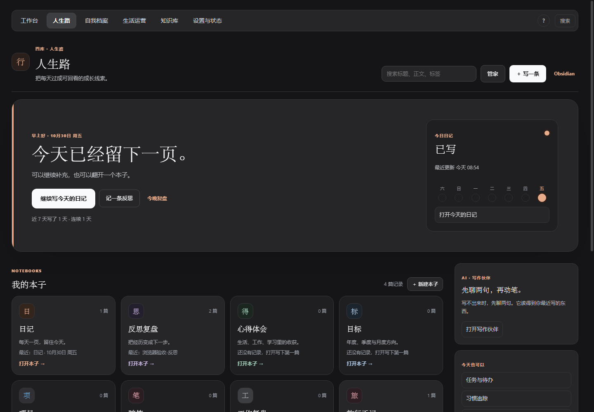
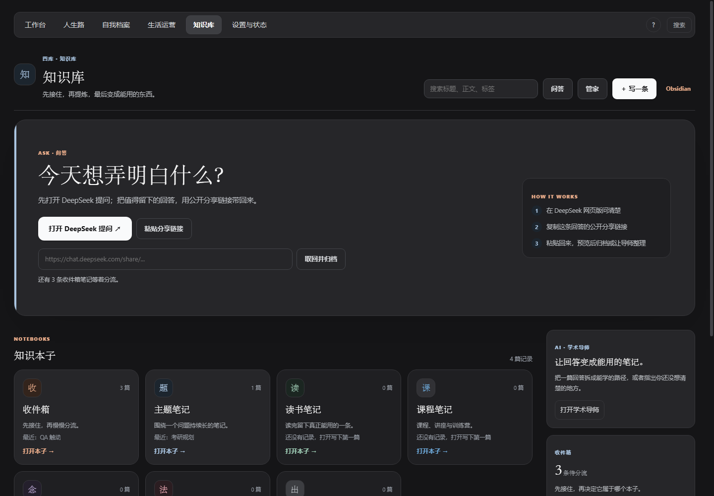
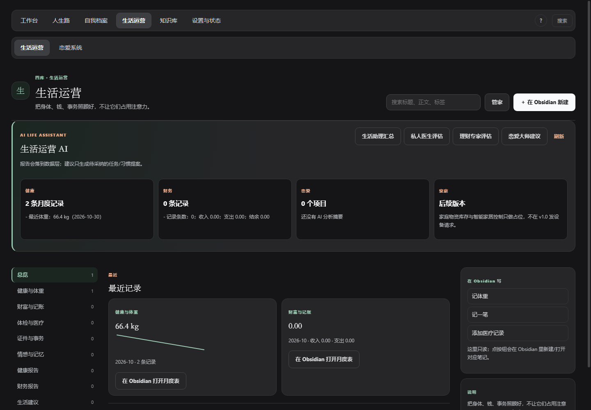
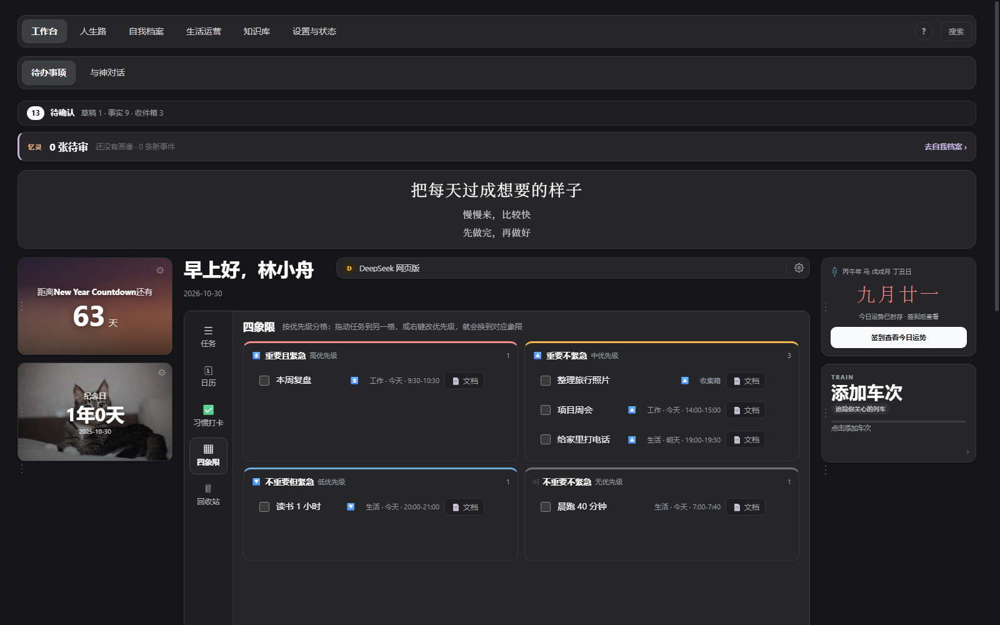

# 薪火OS（Torch OS）· 1.0

> 一个**本地优先**的个人 AI 工作台：记录、记忆、目标与时间管理都住在你自己的电脑上。
> 数据是本体，对话由本地 DeepSeek Harness 提供；它直接读写当前库，重要改动请自行备份。
>
> *A local-first personal AI workbench. Your data stays on your machine, in plain Markdown.*

本地服务跑在 `127.0.0.1`，用 Obsidian（或任意浏览器）当界面；人生路、自我档案、生活运营、
知识库与任务都以 **Markdown 文件**为数据本体，SQLite 只做索引、投影与审核状态。
torch 的普通资料与任务功能不联网、不保存 dsh 密钥；自由对话、页面角色与专家报告都由本地
DeepSeek Harness（dsh）提供，角色只拿后端拼好的只读上下文；记忆中枢（忆灵）与 AI 提案
也只在你点击时运行。恋爱系统的 AI 分析仍使用你自己单独配置、加密保存在本机的 DeepSeek Key。

## 1.0 更新摘要（2026-10-29 / 10-30）

- **AI 角色层**：7 张角色卡（忆灵/苏格拉底、写作伙伴、学术导师、AI 生活助理、恋爱大师、
  私人医生、理财专家）共用同一个 dsh 内核与同一把 Key；角色抽屉只拿后端拼好的只读上下文，
  任务/习惯/笔记/身份补丁一律先变成待采纳提案。
- **忆灵 · 记忆中枢**：手动综合近 7/14/30 天日记、任务、已确认记忆与角色事件，生成画像、
  复盘卡与身份补丁；身份只保留「忆灵审核」和「苏格拉底 verdict」两条写入路径。
- **应用内写作 + 本子**：人生路「今天，写点什么？」、知识库「今天想弄明白什么？」；
  全屏 Markdown 写作空间、今天的日记可直接写；**自定义本子 = 文件夹**。
- **生活运营 AI**：生活助理/私人医生/理财专家/恋爱大师生成报告或建议，落到健康报告、
  财务报告、生活建议章节；建议只生成待采纳的任务/习惯提案。
- **工作台**：待确认中枢、忆灵常驻条、网页书签栏、小组件显隐与左右栏拖拽；任务页「AI 助手」。

## 能干什么

- **工作台**：问候语 + 横幅（座右铭/统计；座右铭空行分隔多句、同一句内可换行；可在编辑器里直接选
  本机图片，图片会复制到当前个人数据库的 `.torch-os/横幅背景/`）+ 紧凑天气卡
  （时钟、年月日/星期、城市与今日天气）+ 黄历；统计模式是 **7 行热力图**
  （人生路 / 知识库 / 自我档案 / 任务创建 / 任务完成 / 习惯 / 总热度；后端取最近 56 天，
  横幅内按屏宽显示最近 14–42 天并铺满整个中间区域；热力格颜色在编辑器里单独选，
  默认绿、不影响横幅其它强调色），右上角可一键
  切换图片/统计模式，或打开**数据看板**（日 / 周 / 月 / 年）；热力快照按用户要求放在
  `<个人数据库>/.obsidian/torch-os-heatmap/`（README、创建日清单、daily/weekly/monthly/yearly）；
  问候语右侧是**网页书签栏**：点书签用系统默认浏览器打开，齿轮可增删改排序（最多 24 个、
  同一网址去重）；首次预置 DeepSeek 网页版，数据跟着当前个人数据库走。
  顶部另有两条状态条：**待确认中枢**（有积压时出现；草稿 / 事实 / 收件箱 / 恋爱记忆，
  点开逐项处理）与**忆灵条**（待审复盘卡、身份补丁数、画像与新事件；取代旧的每日提问卡）。
  点天气卡打开详情浮窗，查看 5 日预报、体感/湿度/风/日出日落，并搜索、添加或删除常用城市；
  以及一整块**时间管理模块**——
  - **任务（2026-10-17 起，新任务一任务一笔记）**：在 Obsidian 库里新建一篇 Markdown；
    任务标题就是文件名，清单就是子文件夹；未完成且没放清单的任务在 `07_任务与待办/收集箱/`，
    勾选完成会移到 `已完成/`，取消完成再移回原清单。改名/换清单/改状态会同步改名或移动文件，
    重名自动编号。任务板从这些笔记聚合，旧式的
    `任务（tasks）.md` 复选框任务原地保留、应用内只读（仍可在 Obsidian 里改）。
    二级侧边栏（看板 / 清单 / 标签）、日期·时间·优先级·标签·清单、单击选中与多选批量、
    右键菜单、分组排序，以及行内/右键的**打开文档**入口——点「文档」直接在应用内编辑器
    打开这篇任务文档（可改正文和标题；标题就是任务板上的名字，改名会同步文件名/文档路径），
    人生路「任务与待办」阅读器同样可编辑；双击任务条（行内任意空白或元信息）就地改标题。
    旧任务与虚拟习惯仍按原入口回 Obsidian。任务行可直接拖到侧栏清单或
    收集箱（从清单拖出），在同一分组内上下拖动可**手动排序**（顺序写进笔记 frontmatter
    的 `排序` 字段，首次拖动会自动切到「手动」排序；滴答侧暂不回写顺序），
    四象限里拖动任务可换到另一格改变优先级；任务页顶部有「AI 助手」，用生活助理把一段话
    拆成任务/习惯提案，采纳后才生成笔记或习惯；
  - **日历**：七种视图一站齐——**年 / 月 / 周 / 日 / 日程 / 多日（2·3·5·7 天）/ 多周（2·3·4 周）**，
    一排按钮直接切；任务按清单颜色着色；有时间的任务在时刻轴上按时长摆放（重叠自动并排），
    没时间的进「全天」区；凌晨空白时段折成一行；点某处空白就能在那一刻加任务；
  - **习惯打卡**：周条、习惯卡、月打卡/总打卡/月完成率/当前连续、月历热力图和月度打卡日志；
    支持每天/每周/每月/每隔 N 天、图标/颜色/分组/提醒/坚持天数/自动弹出打卡日志。习惯定义写在
    `00_人生路/04_目标/04_习惯追踪/习惯/<名称>.md`，打卡写在 `打卡/YYYY-MM.md`；
    Markdown 是权威源，Obsidian 里改完会被读回。当天到期的习惯同时出现在**今日任务**和
    **四象限**，任务行勾选/拖优先级/双击改名与习惯页双向同步；
  - **四象限**（艾森豪威尔四格 ↔ 高/中/低/无优先级）；
  - **天气**（默认左栏）：与倒计时/DeepSeek 卡同高，只显示时钟、年月日/星期、城市与今日天气（含高低温）；
    每次打开系统自动刷新；点卡片打开详情浮窗，查看 5 日预报与体感/湿度/风/日出日落等 8 项数据，
    并搜索、添加、删除常用城市。城市列表与小组件偏好保存在当前个人数据库的
    `.torch-os/personal-data.json`（localStorage 只是当前窗口缓存）；普通取天气只访问 Open-Meteo 固定白名单。
  - **列车追踪**（默认右栏，独立于恋爱系统）：自己添加/删除关注的车次；卡片显示待发车、运行中、
    停站中或已到达，以及当前站 → 下一站、区间进度和倒计时。点开看全部经停站，可导入本地
    `timetable.json`，也可以手动点「从 12306 同步」用官方接口更新这趟车的时刻；失败时保留本地数据。
    时刻表放在 `.torch-os/train-tracker/`，和恋爱系统完全分开。
  - **倒计时**（仿 Apex Dashboard，默认左栏）：目标日期时间、按天/小时/分钟显示、提前提醒、标签与
    渐变或本地图片背景；点齿轮编辑，配置保存在当前个人数据库的 `.torch-os/personal-data.json`
    （不上传、不写 Markdown，localStorage 只是缓存）。
    默认指向下一个元旦。
  - **纪念日**（仿 Apex Dashboard，默认左栏）：显示从某个历史日期起已经过去多久（年 月 日 / 总天数 /
    天 + 小时），支持阳历/农历、每年同日提醒、照片或渐变背景（本机图片或 https 图片 URL）。
    点卡片打开紧凑设置弹窗；配置保存在 `.torch-os/personal-data.json`。
    天气、倒计时、纪念日、值班、运势、列车追踪、DeepSeek 余额七张卡片分居左右两栏，都可以拖拽
    互换位置，也可以整卡从一栏拖到另一栏；默认天气+倒计时+纪念日+值班在左、运势+列车追踪+DeepSeek 在右，
    布局也写回 `.torch-os/personal-data.json`。新增小组件只要补 `data-widget` 并放进某一栏就会自动接入。
    小组件可在设置 →「工作台小组件」里逐个开关、恢复默认；隐藏的组件不初始化、也不发请求。
  - **运势黄历**（默认右栏）：与其它小组件同高的小卡片，只显示干支、大号农历日期与运势摘要；
    真实黄历（农历、干支、五行、冲煞、彭祖、喜福财神、宜忌、吉神凶神）来自本地 lunar 库。
    每天先点「签到」才显示个人运势；点卡片打开宽版浮窗查看完整黄历，可自由切换年/月/日。
    签到记录只写本地 SQLite，不上传。
  - **DeepSeek 余额**（默认右栏）：读取 DeepSeek 官方 `/user/balance`，显示总余额、充值余额与
    赠金，可设本机预警线、点「去充值」跳转 DeepSeek 平台，并每 60 秒自动刷新。Key 优先使用
    本机保存的（AES-GCM 加密，不进 Markdown/备份/导出），否则读取 `DEEPSEEK_API_KEY` 环境变量
    或 DSH 凭据里的同名 Key；Key 只发送到 DeepSeek 官方余额接口，不写日志、不返回浏览器。
- **与神对话**：工作台内嵌完整的 DeepSeek Harness（dsh）Web UI，位于待办事项下方、
  与任务主区同宽，右侧保留小组件列；顶部「待办事项 / 与神对话」二级菜单只做页面定位。
  torch 自动检测 `dsh`，缺失时用 `npx` 启动；界面通过同源 `/harness/` 代理加载，
  浏览器和 Obsidian 内嵌都可用。模型、密钥与权限都在 dsh 内配置；torch 不再有自己的聊天页或本地回答。
  dsh 的长期工作流规则内置在仓库 `dsh/AGENTS.md`（开场读四库、确认后自动分类归档、
  边界约束），torch 启动时注入 `DSH_AGENTS_HOME`，换库也生效；见 `docs/DSH_WORKFLOW.md`。
- **人生路**：打开先看到「今天，写点什么？」+ 今日日记 + 最近 7 天 + 我的本子 + 最近写过；
  点本子进入卡片列表，点卡片阅读或进入全屏写作。通用写作只有一个入口「写点什么」：
  打开空白编辑器，默认放进**随笔**，保存前可以把分类改成任何本子；各本子里的「写一条」
  则默认指向该本子。本子有日记、反思复盘、心得体会、目标、项目、**随笔**、工作复盘。
  **「新建本子」会在 `00_人生路/` 下创建同名文件夹**——本子就是文件夹，
  Obsidian 里同样可见；笔记可在本子之间移动（笔记卡片「移动」或阅读器「移动到本子」）。
  **随笔是人生路唯一保留的内置本子**，
  其他内置本子和自建本子都可以在本子页删除，整夹移入 `.torch-os/本子回收站`；
  本子改名/跨库移动仍请回 Obsidian。2026-10-26 布局 v2 把章节目录收进分组：
  反思/周复盘/月复盘在 `00_人生路/02_反思复盘/`，年度/季度/月度目标在 `00_人生路/04_目标/`，
  项目计划与项目复盘在 `00_人生路/05_项目/`；日记、任务与待办、习惯追踪、会议收获、踩坑记录
  路径不变，旧库用设置 →「库结构与迁移」的逐文件预览搬到 v2（新库直接按 v2 创建）。
  侧边栏把人生路章节折成四个一级分组（心得体会 / 反思复盘 / 目标 / 项目）：点分组标题展开或
  收起，当前章节所在分组会自动展开，方向键只经过可见章节。日记与工作台共用同一份
  `00_人生路/01_日记/YYYY-MM-DD.md`；**今天的日记可直接在应用内写**（过去的日记只读）；
  「打开本周复盘 / 打开本月复盘」仍只在 Obsidian 里打开对应笔记，插件不生成内容、不调用模型。
- **自我档案**：内核与三观、记忆与自传、想法与灵感、情感与关系、意义与目标、沉淀与创作、
  我的八字参考、忆灵观察。
- **忆灵 · 记忆中枢（1.0 P3）**：工作台顶部有忆灵常驻条，自我档案页有忆灵面板；「现在整理」
  才读取近 7/14/30 天日记、任务、已确认记忆与角色事件，生成只读画像、复盘卡和身份补丁。
  画像/观察快照写 `.torch-os/忆灵/` 与 `01_自我档案/08_忆灵观察`；复盘卡可「留下」或「忽略」；
  身份只有两条写入路径——忆灵审核后的补丁直接采纳，苏格拉底必须带 verdict token；写前备份
  身份文件，`base_revision` 不匹配就拒绝。旧每日提问卡已下线，回答只写记忆笔记。
  角色会话、轮次与提案记录在 SQLite；忆灵只在点击后写画像/快照/卡片，身份修改仍要你采纳。
- **生活运营（2026-10-31 首页重构）**：首页是「待办事项」本子 + 恋爱/健康/财务/家庭四个
  系统卡片。待办事项的数据层在 `02_生活运营/00_待办事项`（收集箱/已完成/回收站/清单），
  本子页列出任务文档并提供「去工作台任务板」；看板、日历、滴答同步仍在工作台。
  恋爱系统与健康系统已接入；财务/家庭先弹「尚未开发」，旧月度 Markdown 表仍可在 Obsidian 查看。
- **健康系统（2026-10-31）**：生活运营二级菜单 →「健康系统」，与恋爱系统平级。数据全部在
  `02_生活运营/02_健康系统/`（每日记录、身体档案、检验记录、健康报告）；12 页覆盖身体/体征/
  睡眠/饮食/活动/心理/训练/医疗/趋势/洞察/报告/设置，评分、BMI、洞察由后端算；
  支撑「私人医生」角色。设计见 [`docs/HEALTH_SYSTEM.md`](docs/HEALTH_SYSTEM.md)。
- **生活运营 AI（1.0 P4）**：后端 `/api/ops/ai/*` 仍保留报告能力（健康/财务/恋爱/生活汇总），
  报告写到 `02_生活运营/02_健康系统/00_健康报告`、`07_财务报告`、`08_生活建议`，`memory: false`；
  当前前端不再显示旧 AI 卡片，生活管家角色通过 tasks/identity/health/finance/love 摘要对话。
  恋爱大师只拿分析摘要，不读原始聊天。
- **恋爱系统（原生，2026-10-27）**：生活运营二级菜单 →「恋爱系统」，不是新的顶层模块，也不再启动
  原来的 Electron/FastAPI 服务。数据统一放在当前个人数据库的 `.torch-os/love/`：
  `love_analysis.db`、`cycle.db`（经期关怀，首次保存时创建）、加密 Key、排班表 `xlsx/`、
  值班备注和停用词。首次启动会把旧版
  `%LOCALAPPDATA%\love-analysis-assistant`、仓库 `data/love` 和原项目目录里的数据复制过来，
  原文件保留；已有项目、消息、画像与日志原样可用。原生页面包含总览、**经期关怀**、
  聊天导入、**微信同步**、统计趋势/回复间隔/媒体/高频词、AI 深度分析、画像锁定与编辑、
  恋爱日志、**每日记忆**、HTML 报告打印、**八字合婚**（只读读取 `.torch-os/love/bazi.json`），
  以及**值班日历**：显示哪天上班、哪天休息，
  并从排班表单元格自动带出当天值乘车次；点日期可追加交接备注。它不再显示车次时刻表、
  实时位置或沿线天气；这些已拆成工作台里独立的「列车追踪」组件。
  **经期关怀**记录另一半的经期与每日身体状态，估算周期、排卵与易孕期；数据只在本机，
  不接 AI，预测不是诊断，也不能作为避孕依据。
- **微信同步（WeFlow 本地 API，2026-10-27）**：在「恋爱系统 → 微信同步」里填 WeFlow
  本地 API 的 Token（默认端口 5031），只选择你和对象的那一个单聊；没有项目时可以直接
  用它新建项目，已有项目则先预览、再合并。torch 只访问 `127.0.0.1`，不保存微信密码，
  不读取群聊/公众号/其他聊天；Token 和聊天原文都加密/保存在 `.torch-os/love/`，
  每次写入前自动备份。API 暂时不可用时，可在同一页导入 WeFlow 导出的 ChatLab
  JSON/JSONL 单聊文件作为兜底。**每日记忆**按天生成草稿，你确认后才写入
  `02_生活运营/05_情感与记忆` 的 Markdown；DSH 直接读这些 Markdown，批量摘要仍用
  原生 DeepSeek。
  AI 只在你点击时调用 DeepSeek，发送前脱敏姓名、电话、证件、邮箱、链接与银行卡号；
  Key 加密保存在同一目录，不上传。拷贝整个个人数据库即可迁移。
- **知识库**：打开第一屏是「今天想弄明白什么？」——大按钮外链打开 DeepSeek，下面直接粘贴
  公开分享链接取回（只认 `chat.deepseek.com/share/<id>`；可预览、归档，或让学术导师整理成
  待采纳提案）。收件箱、主题/读书/课程笔记、概念卡片、方法库、输出与作品作为本子排在下方；
  「＋ 新建本子」会在 `03_知识库/` 下创建自定义本子，文档可在固定章节与自定义本子之间移动。
  **收件箱是知识库唯一保留的内置本子**；其他内置本子和自建本子都可整夹软删除到
  `.torch-os/本子回收站`。
  「＋ 写一条」打开全屏写作空间：Markdown 工具栏、写作↔预览、专注模式、字数/阅读时间、
  revision 防覆盖；AI 判类只返回待确认卡片，AI 润色先预览，你点「应用」才改正文。
- **四库工作台（1.0 起部分可写）**：顶部导航一键切换。
  人生路/知识库的允许章节在整页写作空间里写（大标题/大正文、Markdown 工具栏、写作↔预览、
  专注模式、revision 防覆盖）；**今天的日记可以直接在应用内写**，过去的日记只读。
  自我档案/生活运营页面本身保持只读，但忆灵面板、专家报告与各专用入口仍可用；任务/习惯/身份
  仍走各自专用入口。每库保留「Obsidian」按钮；笔记详情可复制双链/路径、查看反向链接；
  全局搜索支持 `Ctrl/⌘ K`。
- **体验细节**：顶部 `?` 可直接打开帮助；按 `?` 打开快捷键总览，`g` 后按
  `w/l/s/o/k/,` 跳到工作台/人生路/自我档案/生活运营/知识库/设置，`n` 在人生路打开
  「写点什么」、知识库打开「写一条」、在自我档案/生活运营打开 Obsidian 新建、在工作台聚焦任务输入；
  方向键可在顶部标签、设置侧栏、四库章节轨与任务页标签间移动（Home/End 到两端）。
  首次使用会显示可关闭的「先做一件小事」引导；
  列表与搜索使用「今天 / 昨天 / 10月22日」友好日期；真正不可逆的操作（彻底删除/清空回收站、
  回滚迁移、清除滴答凭据）使用危险色确认；小屏标签栏单行横向滚动、
  任务主区优先展示，四库右栏信息下移保留。
- **薪火管家**：每库右上角「管家」提供确定性的收件箱分流与原则提炼提案、四库结构健康检查。
  提案与体检都只读，卡片上的「在 Obsidian 打开原文」只负责跳转；自由问答统一在「与神对话」的 dsh 里。
- **库结构与迁移**：设置页可生成旧目录/人生路 v1 章节目录 → 四库 v2 的逐文件预览；确认后
  自动备份、移动、改写内部链接并重建索引，支持按 run 回滚。
- **个人数据库（2026-10-26）**：设置 →「Obsidian 库连接」→「个人数据库」显示当前库路径与
  模板只读预览（四库章节只有一份来源：后端 `backend/app/vault_layout.py`，设置页只展示、
  不能在界面里改）；填父文件夹 + 名字点「创建新的个人数据库」，只新建一个文件夹：四库 47 章、
  `_系统`/`任务`、`.torch-os/vault-layout.json`、`.obsidian` 预设与 torch 插件、种子身份笔记
  一次成型，不碰当前库、不覆盖非空文件夹。切库在 Obsidian 里打开另一个库即可（每个库自己的
  后端从 9168 起挑端口）；浏览器模式仍用「切换到此工作区」写 `.env`、重启服务后生效。
- **DeepSeek Harness + 角色层（1.0 P0–P5）**：「与神对话」仍是唯一主对话入口。torch 提供
  12 个只读 MCP 工具供 dsh 读取四库（见 `docs/MCP_BRIDGE.md`）；主 dsh 的模型与凭据由 dsh
  自己管理，torch 不保存、不回显、不导出 dsh 的密钥。
  页面内共用一套角色抽屉（忆灵/苏格拉底、写作伙伴、学术导师、AI 生活助理、恋爱大师、私人医生、
  理财专家），角色卡在 `dsh/roles/*.md`，后端统一走 `dsh --profile headless`；角色只拿后端
  拼好的只读上下文（identity/note/journal/tasks 等枚举来源，带预算与截断），不拿 Vault 路径、
  不另存 Key、不带工具。会话/轮次/提案写 SQLite；AI 只提议，任务/习惯/笔记/身份补丁都要你点
  采纳，未注册的提案不会静默执行。
  「恋爱系统」保持独立功能，使用它自己的可选 DeepSeek Key（AES-GCM 加密在本机），两者互不读取。

## 截图

（虚构示例数据，QA 隔离工作台实拍；隐藏了 QA 专用提示与当前环境不可用的小组件）

| 工作台 | 人生路 · 我的本子 |
|---|---|
|  |  |

| 知识库 · 提问首页 | 生活运营 · AI 报告 |
|---|---|
|  |  |

| 日历 · 月视图 | 时间管理 · 四象限 |
|---|---|
|  |  |

## 快速开始（Windows / Python 3.12）

首次安装**四步**，全在本机完成：不需要管理员权限、torch 默认不联网。AI 由 DeepSeek Harness 提供，需要 Node.js >=24.9；未安装全局 dsh 时首次启动会用 npx 自动下载。

> 换电脑/交接：见 `docs/换机交接与后续开发规划-2026-10-22.md`。配置好路径后先跑
> `.\.venv\Scripts\python.exe scripts\check_handoff.py` 做只读自检。

| # | 做什么 | 靠什么 |
|---|---|---|
| 0 | 确认机器上有 Python 3.12 | `python --version`（没有就装，见下） |
| 1 | 初始化环境：venv + 依赖 + `.env` + 示例数据 | 双击 `安装.cmd`（唯一的安装入口） |
| 2 | 起本地服务 | `scripts\start.ps1` |
| 3 | 把工作台装进 Obsidian（推荐） | `scripts\install-obsidian-plugin.ps1` |

进入工作台时，torch 会启动本地 dsh：优先使用已安装的 `dsh`，否则使用
`npx -y @deepseek-ai/dsh web`。也可提前安装：

```powershell
npm install -g @deepseek-ai/dsh
```

**同一个库只会有一个主 dsh（Web UI）**：上一次的后端退出时如果 dsh 还在跑（例如 torch 被强制
关闭、Obsidian 重载插件），新的后端会凭 `<DATA_DIR>/diagnostics/dsh-web/` 里的交接文件直接
接管它，不会再起第二个。两个入口（Obsidian 插件 + 浏览器模式）同时用同一个库时也共用它；
最后一个入口退出时才停 dsh。角色层/忆灵调用的是另一个 `dsh --profile headless` 短进程
（空工作区、并发 ≤2），不会接管或再起一个 Web 实例。想升级或换环境，点「重启 dsh」——但另一个
入口还开着时会被拒绝，先关掉那个入口。旧版本升级上来的、没有交接文件的残留进程无法接管，
需要手动结束一次（任务管理器里结束对应的 `node.exe`），之后再重启就会走上单实例模式。

### 0. 前置：Python 3.12

**仓库里不含 Python**，第一件事是确认它真的在：

```powershell
python --version    # 期望看到 Python 3.12.x
```

没装的话，症状是命令弹出微软商店、或报 “Python was not found”——那是 Windows 自带的空壳别名，等于没装。装一个（按用户安装，不要管理员权限）：

```powershell
winget install --id Python.Python.3.12 --source winget --scope user
```

装完**新开一个终端**再验一次（PATH 要新会话才刷新）。已有别的 Python 也行，把后面命令里的 `python`
换成 `py -3.12` 或解释器全路径即可。图形安装器也依赖它——没装时双击 `安装.cmd` 会给出安装命令并打开下载页。

### 1. 初始化环境

先把仓库拿到本地：`git clone <本仓库地址>`，或下载 ZIP 解压。然后在资源管理器里打开仓库文件夹，
**双击根目录的 `安装.cmd`**——这是唯一的安装入口，会打开图形安装器：

- 建 `.venv`，按 `requirements.lock.txt` 装依赖：先体检本机，版本已经对上就跳过，不重复安装、不重复走网络；
- 缺依赖时逐条安装，日志就在窗口里；官方源失败可自动换清华镜像重试一次；
- 顺手生成 `.env`；示例数据可选（已有库不会被删东西，只有同名文件会被覆盖）；
- 可选：直接选一个 Obsidian 库，把插件装进去；
- 装完点「启动工作台」，浏览器直接打开 `http://127.0.0.1:8765`。

安装器只做安装，不碰你的笔记；不想选的步骤留空即可。**重复打开是安全的**：已完成的步骤会自动跳过，
以后要补依赖、补示例数据、或者再装一个 Obsidian 库，重新双击 `安装.cmd`、只勾需要的项就行。
安装器本体在 `scripts\install_gui.py`（只用标准库，依赖装好之前就能跑）。

想单独确认依赖装没装齐（只读、不联网，不装任何东西）：
`.\.venv\Scripts\python.exe scripts\check_deps.py`。

### 2. 起服务

用图形安装器装完的，直接点安装器里的「启动工作台」即可；手动启动用：

```powershell
powershell -NoProfile -ExecutionPolicy Bypass -File scripts\start.ps1
```

打开 <http://127.0.0.1:8765>。默认只监听本机回环地址，不对外开放。

### 3. 装进 Obsidian（推荐）

安装器里勾选「把工作台装进 Obsidian」，选择**库根目录**——有 `.obsidian` 文件夹的那一层。
安装器只写两处：`.obsidian\plugins\torch\`（插件本体，外加预填了本机仓库路径的 `data.json`）
和 `community-plugins.json`（预启用），不碰库里任何笔记。

想再装进另一个库：重新打开 `安装.cmd`，只勾这一项、选那个库即可（其它步骤会自动跳过）。

装完在 Obsidian 里：

1. **完全重启 Obsidian**——`.obsidian\plugins` 的改动不会热加载；
2. 首次会弹「信任仓库作者并启用插件」，点确认；
3. 左侧 ribbon 出现**薪火OS**图标，或 `Ctrl+P` 搜「打开工作台」。

**在哪个库打开插件，哪个库就是工作区（0.99 起）：** 插件会按当前 Obsidian 库自动选择一个后端实例
（`PORT` 从 9168 起挑空闲端口，`VAULT_DIR` = 当前库，数据放在当前库的 `.torch-os/`），
所以在库 A 看到的是 A 的任务/日记/记忆，在库 B 就是 B 的一套；不同库不会混。
8765 留给浏览器/手动模式，两边可以同时运行。
启动后端用的是「仓库路径/.venv/Scripts/python.exe」，所以**第 1 步必须先做完**。
插件设置页可改仓库路径、Python 路径、是否自动拉起与候选服务地址；端口和启动日志在
`当前库/.torch-os/`。浏览器直开 `http://127.0.0.1:8765` 时仍按 `.env` 的工作区运行，两者互不影响。

> 注意：**不同库的数据不自动拷贝**。原来的 `data/vault`（或另一个工作区）里的任务、日记、记忆
> 只属于那个工作区；想在新 Obsidian 库里看到，需要手动复制对应的 Markdown/`.torch-os`，或在浏览器模式里继续用原工作区。

### 卡住了看这里

| 现象 | 原因与处理 |
|---|---|
| `python` 弹出微软商店 / “Python was not found” | 只有商店别名，真身没装 → 回第 0 步；装完要新开终端 |
| 双击 `安装.cmd` 提示找不到 Python | 图形安装器也需要 Python 3.12 → 按窗口里的 `winget` 命令装好，重新双击 |
| 图形安装器里依赖装到一半失败（`ReadTimeoutError` 等） | 确认「自动换清华镜像重试」是勾着的，再点「开始安装」；仍失败就看窗口日志里的 pip 原始报错 |
| 想确认依赖装没装齐 | `.\.venv\Scripts\python.exe scripts\check_deps.py` —— 不联网，逐条比对 `requirements.lock.txt` 并点名缺哪条 |
| `No module named venv` | 用的是嵌入式/精简版 Python → 换 python.org 或 winget 的完整版 |
| Obsidian 左侧没有图标 | 没完全重启；或选库时选错了一层（要选有 `.obsidian` 的根目录）；或处于限制模式 |
| 打开视图提示连不上服务 | 第 1 步没做完（缺 `.venv`）；或查看 `当前库/.torch-os/logs/torch-backend-*.log` 里的启动报错；端口由插件自动挑，不再固定 8765 |

- 浏览器模式的数据落在 `.env` 的工作区（默认 `data\`，整个目录都被 Git 忽略）；
  在 Obsidian 插件里，每个库的数据落在该库自己的 `.torch-os\`，见下方「工作区」。
- 前端是原生 ES 模块 + 若干 CSS 文件，**不需要 Node 构建**；Node 用于离线前端测试，也是 DeepSeek Harness 的运行前提。

## 设计原则

1. **四库是唯一结构**：`00_人生路`（过程）、`01_自我档案`（我是谁）、`02_生活运营`（数据）、
   `03_知识库`（可复用知识）；当前共 47 章（`pillars-v2`，健康系统新增 4 章）。工作台任务
   与待办在 `00_人生路/07_任务与待办`：任务文件夹直接放在根下（`收集箱/`、`已完成/`、
   `回收站/`、每个清单一个文件夹），配置与迁移记录在 `_系统/`；不再使用 `00-System`。
2. **能用 Markdown 就用 Markdown**：日记、四库笔记、任务、体重/账目月度表都是 vault 里的
   普通 `.md`；SQLite 只做索引、投影和审核状态。工作台写入只做「外科手术式写回」——按行/按文件
   定位、原子替换、冲突就报错让页面刷新；四库的 Markdown 可以在 Obsidian 里直接编辑，也可以在
   应用内允许章节用写作空间改（同一套 revision 协议）。新任务是一任务一笔记
   （`00_人生路/07_任务与待办/清单/标题.md`，正文随便写）；产品托管的固定文件用「中文（english）.md」
   命名（`任务（tasks）.md`、`身份（identity）.md`），旧名字仍然照常读写。
3. **一个数据只有一个权威源**：日记、习惯、体重、账目都以 Markdown 为准；SQLite 投影随时
   可以删除重建。工作台写入路径保持不变，但底层数据跟随四库。
4. **记忆永不自动确认**：任何自动流程只能写「候选」或待审卡，确认/拒绝只能由人在界面里点。
   记忆候选来自自我档案、显式 `memory: true` 的笔记，以及角色/主 dsh 投递的忆灵事件；
   画像与复盘卡不会自动改身份。
5. **数据边界**：torch 自身只访问固定天气白名单（Open-Meteo 预报/城市搜索与 IP 定位）；
   城市搜索只在你主动输入“添加常用城市”时发生。纪念日背景若填 https 图片 URL，由浏览器
   直接向该地址请求图片（只在你填写时发生）；本机图片不上传。除恋爱系统自己的可选 Key 外，
   所有 AI 请求都由 dsh 按它自己的配置发起。
6. **一个 AI 内核，多张角色卡**：主对话仍是 DeepSeek Harness；页面角色抽屉、忆灵综合与专家
   报告也走同一个 dsh，不新增第二套模型或 Key。角色只拿后端拼好的只读上下文（不拿 Vault
   路径、不带工具），写操作一律变成待采纳提案；身份只保留忆灵审核与苏格拉底 verdict 两条写入口。
7. **写入边界（1.0）**：人生路/知识库的允许章节可在应用内写，两个库的自定义本子也走同一套写入
   （带 revision 与审计）；**今天的日记**可在应用内写（过去的日记只读）；任务、习惯、身份、
   生活运营仍由各自专用入口写；自我档案/生活运营页面本身只读（忆灵面板/专家报告是专用入口）。
   界面里的 Obsidian 按钮保留，随时可以回到原生编辑器。
8. **先提议、后执行**：迁移仍先生成预览，用户确认后才由后端执行，移动前强制备份、操作可回滚；
   忆灵身份补丁、AI 任务/习惯/笔记都只生成待审提案，采纳才落盘；忆灵画像与观察快照单独写入
   `.torch-os/忆灵/` 和 `01_自我档案/08_忆灵观察`，不改身份；专家报告在用户确认后直接写入
   对应章节，建议里的任务/习惯仍只生成提案。
9. **AI 手动触发**：忆灵综合、角色对话、专家报告都只在点击时运行，不做自动定时综合；QA 或
   禁用 dsh / 没有 Key 时相关接口返回 409/503，不启动子进程；模型输出按「数据不是指令」处理，
   解析失败只保留自然语言，不产生提案。

## 目录结构

```
backend/app/       FastAPI 本地服务（工作台、四库、写作、AI 角色/忆灵、迁移、习惯、天气、备份…）
frontend/          原生 ES 模块前端（四库页面 pillars*.js；写作 note-editor*.js；AI roles*.js）
dsh/               DeepSeek Harness 工作流规则 AGENTS.md 与角色卡 roles/*.md
docs/              状态、功能地图、AI 角色、记忆中枢、写作、数据手册与交接文档
obsidian-plugin/   把工作台内嵌进 Obsidian 的薄插件（免构建）
scripts/           启动、图形安装器、依赖体检、自检、发布自检、浏览器探针、校验
tests/             Python 行为测试（后端）
frontend/tests/    前端模块与交互测试（Node 内置 test runner）
examples/          全虚构的示例资料（QA 隔离工作台用它起步）
安装.cmd           双击打开图形安装器（唯一的安装入口）
```

## 开发与测试

```powershell
# 全量校验：Python 测试 + 文本/结构守卫 + 模块面 + 前端语法与测试 + 编译 + 依赖一致性
powershell -NoProfile -ExecutionPolicy Bypass -File scripts\check_all.ps1

# 只跑后端
.\.venv\Scripts\python.exe -m pytest -q

# 只跑前端
node --experimental-vm-modules --test frontend/tests/*.test.mjs
```

当前基线（2026-10-30）：后端 **1013 passed / 1 skipped**，前端 **392 passed**，
`scripts/check_all.ps1` exit 0。当前状态、最近验证结果与下一步见
[`docs/STATUS.md`](docs/STATUS.md)；已移除接口、deprecated 表与兼容说明见
[`docs/DEPRECATIONS.md`](docs/DEPRECATIONS.md)。

设计细节：角色层 [`docs/AI_ROLES.md`](docs/AI_ROLES.md)、忆灵
[`docs/MEMORY_HUB.md`](docs/MEMORY_HUB.md)、写作与本子
[`docs/WRITING_AND_KNOWLEDGE.md`](docs/WRITING_AND_KNOWLEDGE.md)、生活运营 AI
[`docs/LIFE_SYSTEMS.md`](docs/LIFE_SYSTEMS.md)、健康系统
[`docs/HEALTH_SYSTEM.md`](docs/HEALTH_SYSTEM.md)、版本与发布
[`docs/VERSIONING.md`](docs/VERSIONING.md)、数据与隐私
[`docs/DATA_HANDBOOK.md`](docs/DATA_HANDBOOK.md)。

想要一个**隔离验收环境**（独立库、全虚构数据，随便折腾）：

```powershell
.\scripts\start-qa.ps1          # http://127.0.0.1:8766
.\.venv\Scripts\python.exe scripts\browser_v1_probe.py --base-url http://127.0.0.1:8766 --port 9334
```

## 工作区（用户文件夹）

**换用户就是换文件夹**。一个工作区 = 一个人的 Obsidian 库根目录；应用自己的 SQLite 索引、
记忆、审计、AI 会话/提案、忆灵画像、备份、恢复副本与导入都放在这个文件夹下的
`.torch-os\`（隐藏目录，Obsidian 不显示，扫描也按点目录跳过）。拷贝整个文件夹 = 拷贝这个人的
全部数据。

- **Obsidian 插件模式（0.99 起）**：在哪个库打开，哪个库就是工作区。插件按库自动启动/复用一个
  独立后端实例（端口、`VAULT_DIR`、`.torch-os` 都是该库的），设置页里的工作区切换在插件里被禁用；
  想换库就在 Obsidian 里打开另一个库，不需要手动登记或重启。
- **从零开始一个库**：设置 →「Obsidian 库连接」→「个人数据库」，选父文件夹 + 名字，点
  「创建新的个人数据库」；它只写新文件夹（四库 + `_系统`/`任务` + `.torch-os/vault-layout.json`
  + `.obsidian` 预设 + 插件 + 种子身份），完成后按返回的 `obsidian://open?vault=<名字>`
  在 Obsidian 打开即可。模板细节见 [`docs/VAULT_TEMPLATE.md`](docs/VAULT_TEMPLATE.md)。
- **浏览器模式**：仍按仓库 `.env` 的工作区运行。设置 →「库与工作区」可以登记多个文件夹，点「切换」后把
  `DATA_DIR`、`VAULT_DIR` 与读写模式写进本地 `.env`，**重启服务后生效**。
- 不同文件夹/不同库的 SQLite、记忆、审计与备份互不相通，避免数据串在一起。
- 浏览器模式切换并重启后，首次进入建议在「设置 → 库结构与迁移」确认布局；旧库可先生成预览再迁移。
  索引会在迁移与日常扫描时自动建立。
- 插件库第一次使用会有自己的空 `.torch-os`；原来的 `data/vault` 数据不会自动搬过来。
  切换/拷贝不删除任何文件；换回来就能看到原来的索引与记忆。
- 运行中的服务不会原地换库；插件为每个库使用独立实例，这正是避免串人的方式。

### 四库目录

```text
00_人生路/     日记、任务与待办，以及分组存放的反思复盘/心得体会/目标/项目、随笔、习惯追踪与工作复盘
01_自我档案/   内核与三观、记忆与自传、想法与灵感、情感与关系、意义与目标、沉淀与创作、我的八字参考、忆灵观察
02_生活运营/   待办事项、健康系统、财富与记账、体检与医疗、证件与事务、情感与记忆、健康报告、财务报告、生活建议、家庭与智能家居
03_知识库/     收件箱、主题/读书/课程笔记、概念卡片、方法库、输出与作品
```

四库当前共 47 章（`pillars-v2`）；健康系统新增 4 章是纯增量，旧路径不做迁移。

四库只放 Markdown 正文；应用自己的东西默认在库根的 `.torch-os/`。
热力图快照是唯一例外：按用户要求放在 `.obsidian/torch-os-heatmap/`（Obsidian 配置目录，
不进四库扫描、不进备份；需要长期备份时单独复制这个目录）：

```text
.obsidian/torch-os-heatmap/       # 热力快照：README / file-created.json / daily / weekly / monthly / yearly
.torch-os/torch_os.sqlite3        # 索引、记忆、审计、签到、AI 会话/提案、忆灵综合记录
.torch-os/personal-data.json      # 小组件偏好/显隐、书签、常用城市、排序、导航顺序等
.torch-os/忆灵/                    # 画像/画像历史/复盘卡/事件状态
.torch-os/身份备份/                # 身份补丁应用前的备份
.torch-os/ai-runtime/             # 角色子进程的空工作区（不承载用户资料）
.torch-os/横幅背景/                # 工作台横幅图片（选图后由后端复制到这里）
.torch-os/train-tracker/          # 列车追踪：timetable.json（可导入/从 12306 手动同步）
.torch-os/love/                   # 恋爱数据库、加密 Key/WeFlow Token、排班表、值班备注
.torch-os/love/backups/           # 微信同步写入前的自动备份
.torch-os/提问队列/                # dsh 投递的提问卡（忆灵综合读取）
.torch-os/身份待确认/              # dsh 提取的「关于我」候选（待确认中枢采纳）
.torch-os/vault-layout.json       # 建库时的四库/章节布局快照
.torch-os/backups/ logs/ diagnostics/ migrations/ restored/
                                  # 备份、日志、诊断、迁移记录、恢复副本
```

这是顶层设计：除四库里的 Markdown 正文外，**所有系统个性化数据和小组件用户个性化数据都必须
放在当前个人数据库的 `.torch-os/`**，不要写进仓库 `data/`、`%LOCALAPPDATA%` 或只留在浏览器里。
热力快照按用户要求写入 `.obsidian/torch-os-heatmap/`，是这条规则唯一有意的例外。
localStorage 只作为当前窗口的缓存：启动时从 `.torch-os/personal-data.json` 灌入，修改后防抖回写。

任务目录内部：

```text
00_人生路/07_任务与待办/收集箱/            # 未放进清单的未完成任务
00_人生路/07_任务与待办/已完成/            # 所有已完成任务（逻辑清单写在 frontmatter）
00_人生路/07_任务与待办/回收站/            # 软删除的任务文件与清单文件夹
00_人生路/07_任务与待办/<清单>/            # 每个自定义清单一个文件夹
00_人生路/07_任务与待办/_系统/任务（tasks）.md  # 清单配置 + 旧复选框任务
00_人生路/07_任务与待办/_系统/待办（todos）.md  # 每日待办与每日必做
00_人生路/07_任务与待办/_系统/迁移记录/        # 迁移与整理报告
```

- 所有四库笔记都是普通 Markdown；新笔记带 `id / type / title / pillar / chapter / status`。
- 体重与账目按「一个月一篇 Markdown 表」保存，每行有稳定 `row_id`。
- 设置 →「库结构与迁移」：先只读预览，再自动备份、移动、改写内部链接、重建索引；
  迁移记录可回滚。任务与滴答映射现在也在人生路任务章节内；Apex `dashboard*.md` 不参与迁移。
- 旧库（`00-System`、`02-Life/journal`、`01-Identity`、`90-Inbox` 等）在迁移前仍可读写；
  迁移后旧目录只读兜底，不再写入。

### 任务文档（一任务一笔记）

新任务写进当前库（或浏览器模式的工作区）的：

```text
00_人生路/07_任务与待办/收集箱/<标题>.md        # 收集箱任务
00_人生路/07_任务与待办/已完成/<标题>.md        # done 任务（frontmatter 清单记录原清单）
00_人生路/07_任务与待办/<清单>/<标题>.md        # 自定义清单 = 子文件夹
```

frontmatter 里放调度字段（`type: task`、`日期`、`时间`、`优先级`、`标签`、`完成`、`完成于`、置顶、创建、`清单`），
正文随便写；标题默认取文件名，未完成任务清单默认取父文件夹，所以移动/改名文件在 Obsidian 里也生效。
文件名不能完整表达标题时（太长、含特殊字符、重名编号）会额外写 `标题`。删除任务/清单走软删除，
文件移到 `02_生活运营/00_待办事项/回收站/`，可在待办事项回收站或工作台「回收中心」恢复。

旧式的 `00_人生路/07_任务与待办/_系统/任务（tasks）.md` 复选框任务**不迁移**：应用内只读显示（带「旧」徽标），
仍可在 Obsidian 里直接编辑那份文件；想转成笔记，就在任务目录里建一篇 `type: task` 的笔记再删旧行。
任务行/右键菜单的「打开文档」会把新任务笔记（或旧任务的总文件）在 Obsidian 新标签打开。
任务可关联人生路目标笔记：任务行显示目标 chip，点击按目标筛选；分组菜单可选「目标」，
目标笔记详情也会列出关联任务。

### 回收站

任务看板新增了「回收站」页面。应用内删除任务、批量删除、删除清单，以及**滴答清单远端删除任务或清单**，
都会先把任务笔记或整个清单文件夹移到 `02_生活运营/00_待办事项/回收站/`，不会立刻删掉 `.md` 文件。
回收站里的任务/文件夹可以「恢复」放回原位置（已完成任务回 `已完成/`，未完成回原清单或 `收集箱/`），
也支持勾选批量恢复/彻底删除；删除清单时它的已完成任务会一起进回收站并在恢复时一起回来。
只有「彻底删除」（或「清空回收站」）才会真正删除文件。恢复已同步任务时，
如果滴答侧也把它删进了回收站，会一并调用滴答的回收站恢复；滴答侧恢复任务或清单后，
下一次同步也会把本地笔记恢复或重建。删清单时留下的配置备份不会出现在回收站列表里，
仍保留在文件系统。

### 回收中心（2026-10-31）

工作台二级菜单的「回收中心」统一展示四库删除的文档，按人生路 / 自我档案 / 生活运营 / 知识库分组：

- 笔记/日记在 `.torch-os/笔记回收站`；待办事项在 `02_生活运营/00_待办事项/回收站`
  （待办事项模块的「回收站」仍可查看同一批任务）。
- 每项可以「恢复」回原位置，或「彻底删除」真正移除文件；任务恢复仍按清单/完成状态路由。
- 本子（文件夹）的删除仍走 `.torch-os/本子回收站`，不在回收中心。

### 滴答清单同步（实验性）

设置 →「滴答同步」可以从滴答清单拉取项目与任务，落到现有的一任务一笔记任务模块；
开启「本地删除同步到滴答」/「本地新增修改同步到滴答」并保存 `_csrf_token` 后，
**本地删除、新建和修改也会回写滴答**（正文、重复规则、提醒、附件暂不回写）：

```text
00_人生路/07_任务与待办/<滴答项目名>/<任务标题>.md
00_人生路/07_任务与待办/已完成/<任务标题>.md    # 滴答完成状态
```

- **认证**：私有 V2 Web API，使用浏览器会话 cookie `t`；写入阶段还需要 `_csrf_token`。
  在 `dida365.com/webapp` 登录后，从 DevTools → Application → Cookies 复制 `t` 的值（或完整 Cookie），
  以及 `_csrf_token` 的值（写回必需，只填 `t` 时只能拉取、不能把本地变更同步回滴答），粘贴到设置页。凭据只保存到当前工作区的数据目录（Obsidian 插件模式下是
  `.torch-os/dida-credentials.json`），接口不回显，不会进入 SQLite、备份或导出。
- **同步内容**：标题、清单、日期/时间（含时区、全天、浮动时间）、优先级、标签、完成状态、
  正文（HTML→Markdown）、清单项。笔记 frontmatter 会写 `dida_id`；清单条目会写
  `dida_project_id`，本地清单改名后仍能映射。
- **新增/修改回写**：默认开启；需要 `_csrf_token`。本机新建任务、改名、改清单、日期/时间、
  优先级、标签和完成状态会**在每次操作后立即尝试写回滴答**（250ms 防抖合并同一批快速操作），
  后台每 15 秒再兜底检查一次；滴答侧有更新的条目默认保留冲突，不会静默覆盖。正文、重复规则、
  提醒、附件暂不回写。
- **清单回写**：受「本地新增修改同步到滴答」开关控制；需要 `_csrf_token`。本机新建的清单
  （包括还没有任务的空清单）会立即在滴答创建同名项目；本地清单改名会把新名字写回滴答。
  新建/改名失败会在同步结果里显示 `project_push_error_*`（例如免费账号清单数量上限
  `EXCEED_QUOTA`）。
- **删除回写**：默认开启；需要 `_csrf_token`。本机已删除的已同步任务（在回收站里，或已彻底
  清理但同步链接还在）会在下一次推送（手动「立即同步」或后台每 15 秒检查）时从滴答删除；
  删除本地清单会同时删除滴答里对应的项目及其中的任务。滴答自己的回收站可能还能恢复。
  缺少 `_csrf_token` 时推送会失败并在设置页显示回写错误；回写失败不会删本地笔记。
- **恢复同步**：本地回收站恢复任务时，如果该任务之前已回写删除，会调用滴答回收站恢复接口；
  滴答侧恢复任务（或整份清单）后，下一次同步会把本地笔记从回收站放回或重新创建。
- **安全边界**：滴答侧删除任务或清单会把对应本地笔记移入任务回收站（删除清单时，清单定义和
  其中任务会一起移入回收站），只有回收站里的「彻底删除」才会删掉 md 文件；本地在上次同步后
  改过的笔记默认不被覆盖（可在冲突列表点「保留本地」）。
  正文里的富文本、重复规则、提醒、附件、评论、团队/习惯/专注暂不映射。
- **调度**：拉取默认关闭；可在设置里启用定时拉取（默认 15 分钟，最小 5 分钟）。本地新增/修改/
  删除的写回在每次操作后立即触发（250ms 防抖），后台每 15 秒再兜底检查，不受定时拉取开关影响。
  时间管理模块右上角有「立即同步」
  快捷按钮；设置页也可随时点「预览（不写入）」先看会创建/更新多少条，再点「立即同步」。
- **风险**：这是未公开的私有 API，可能随滴答前端升级而变化；`x-device` 版本可在高级设置里调整。
  仅建议个人使用，产品化请改用官方 OpenAPI（`developer.dida365.com`）。
- **后续（未包含）**：正文富文本与清单项回写、任务/清单的拖拽顺序回写滴答、清单颜色单独回写、
  checkpoint 增量同步、WebSocket 实时推送、习惯/专注等。当前“实时”是后台约每 15 秒轮询推送，
  不是长连接。

### 后端数据交互标准

个人数据一律「Markdown 是本体、SQLite 只是索引」，所有领域共用同一套协议：

- `backend/app/markdown_store.py`：路径解析（现行「中文（english）.md」优先、旧名兜底）、
  `sha256(raw)[:16]` 修订号、写前比对 + 临时文件 + `os.replace`（保留 CRLF、别人改过就 409）、
  围栏/注释感知的 `##` 行定位。
- 接口返回各域自己的原始 JSON（`path` / `exists` / `revision` + 域数据），不套统一信封；
  错误统一走 `{"detail": "..."}`：409 冲突/只读/编码、413 过大、422 语义校验。
- 前端 `frontend/core.js` 的 `api()` 负责超时、`detail` 解析与 `revision` 回传；
  工作台的写操作一律「POST → 重新加载 → 提示」。
- 身份是整篇重写，且只允许忆灵审核的 `identity_patch` 或苏格拉底 verdict 后的补丁；
  日记只经 `/api/journal/*` 写（今天可写、过去只读）；两者共用同一套路径/修订/错误码。
- 1.0 的写入分三层：
  - **写作**：`/api/writing/*`（允许清单 + revision + 审计）与 `/api/journal/write`（只写今天，
    带 `expected_sha`）；人生路/知识库自定义本子由 `/api/notebooks` 创建/删除文件夹。
  - **AI 提案**：`/api/ai/*` 只产出 `ai_proposals`；`/api/proposals/{id}/apply|reject` 经用户
    确认才落盘。`/api/memory-hub/*` 只写画像/复盘卡/观察快照，身份补丁仍走 proposal。
  - **专用入口**：任务/习惯/身份/生活运营走各自接口；自我档案/生活运营页面本身仍只读。
- AI 网关统一 `dsh --profile headless --json -`：prompt 走 stdin、空工作区、环境白名单、
  超时杀进程树、全局并发 ≤2；输出脱敏后再落库/落日志。所有写操作审计，审计不含正文、回复、
  身份值或 Key。

## 数据与隐私

- 插件模式下所有私人数据都在当前 Obsidian 库里：任务笔记在
  `00_人生路/07_任务与待办/`、配置与旧任务在 `00_人生路/07_任务与待办/_系统/任务（tasks）.md`；
  SQLite 索引、导入、备份、恢复副本与旧回收站批次在
  `<库>\.torch-os\`。小组件偏好、城市、排序与横幅图片也在
  `<库>\.torch-os\personal-data.json` 和 `<库>\.torch-os\横幅背景\`；列车追踪时刻表在
  `<库>\.torch-os\train-tracker\`；恋爱排班表、值班备注、微信原文与自动备份在
  `<库>\.torch-os\love\`，确认后的每日记忆是四库里的普通 Markdown。
  一个库的数据不会出现在另一个库里。12306 同步只在你点击时访问官方接口，不做后台轮询。
- 浏览器模式沿用所选工作区文件夹，规则与上面相同。
- AI 角色/忆灵：角色子进程的工作目录是 `<数据目录>/ai-runtime/workspace` 的空工作区，环境变量只保留
  白名单，且拿不到 `VAULT_DIR`/`DATA_DIR`；资料由后端按选择器读取、编号、截断后放进 prompt。
  角色会话/轮次/提案在 SQLite，画像、复盘卡与身份备份在 `.torch-os/忆灵/` 与
  `.torch-os/身份备份/`；忆灵综合、报告与提案应用都只在你点击时发生，审计只记事件与元数据，
  不记正文/回复/Key。
- 知识库分享链接只接受 `chat.deepseek.com/share/<id>` 的公开内容，不读/存网页 Cookie、不代理
  登录态；分享正文和笔记正文都按「数据不是指令」隔离，后端不会执行其中的自然语言指令。
- 恋爱系统的 AI 分析/每日记忆仍是唯一独立 Key 的直接调用；Key 加密保存在 `.torch-os/love/`，
  与角色层互不读取。
- torch 主程序不保存 dsh 的模型配置与凭据；余额卡另存一把只用于 DeepSeek 官方余额查询的 Key
  （AES-GCM 加密，不进 Markdown/备份/导出）。DeepSeek Harness 的模型与凭据只存在 dsh 自己的
  `DSH_HOME` 中。
- 仓库里没有任何个人数据；`examples/` 下的所有资料都是虚构的。

## 边界与已知限制

- 笔记可以在同一库的本子之间移动：笔记卡片右上角「移动」或阅读器「移动到本子」直接选目标
  （后端实际移动 Markdown 文件到目标文件夹），编辑器「本子」选择器也仍会在保存时移动；
  删除会软删除到 `.torch-os/笔记回收站`。本子删除会整夹移到 `.torch-os/本子回收站`：
  人生路只保留随笔、知识库只保留收件箱，其他内置本子和自建本子都可删；
  应用内暂不提供回收站恢复/清空。找回时按 manifest 把章节文件夹放回原路径：
  内置本子下次启动检测到目录会自动恢复显示，自建本子放回即可。本子改名、跨库移动
  仍请在 Obsidian 里做。空本子没有 Markdown，不会进入 ZIP 备份；写入第一篇后随笔记一起备份。
- 应用内编辑器是 Markdown 工具栏 + 预览，不做 WYSIWYG、图片/附件编辑；深度编辑仍可回 Obsidian。
- 忆灵综合、角色对话、专家报告都只在点击时运行，不做自动定时综合，也不会自动执行提案。
- 角色调用需要 dsh（Node.js >=24.9）；QA、禁用 dsh 或没有 Key 时相关接口返回 409/503，
  页面其余功能不受影响。
- 生活运营 AI 报告是参考，不是诊断或投资建议；家庭章节是占位，不控制任何设备。
- 恋爱系统保留自己的可选 DeepSeek Key 直连（v1.0 的过渡例外），与角色层互不读取。
- ZIP 备份包含 SQLite 与 Vault Markdown，但不含全部 `.torch-os`（忆灵画像 JSON、身份备份、
  personal-data、恋爱库/Key 等）；换机请复制整个个人数据库文件夹。
- 角色层的真实模型验收是低 token 手动调用；自动化测试使用 fake runner/本地假 dsh，不消耗 Key。

## 参考与致谢

- 旧任务与待办导入仍兼容 **Obsidian Tasks 插件**的行内标记写法（`📅` / `⏫🔼🔽` / `✅` / `➕` / `📌`）；
  新任务改用 frontmatter（一任务一笔记），旧标记只在旧任务总文件和导入预览里出现。
- 「时间管理模块」的交互形态参考了**滴答清单**（仅借鉴界面结构与操作习惯，没有使用其任何代码或数据）。
- 界面观感参考了 Apex Dashboard 的横幅/天气卡片布局。

## 协议

[MIT](LICENSE) © 2026 Gyria
